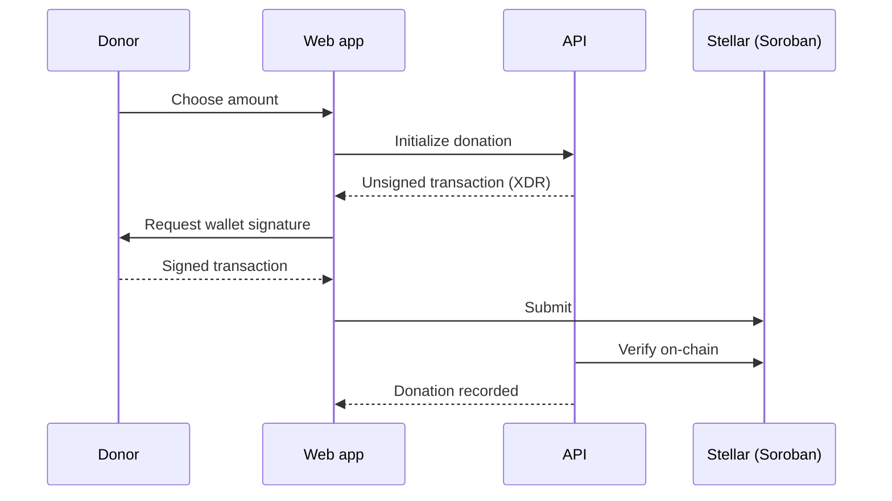

# ⛪ Antioch

> Fund missions, scholarships and church projects with USDC on Stellar. Every release is verified and visible on-chain.


**Links:** [Escrow Contract](https://github.com/eogenyi23-creator/antioch-escrow) | [Report a Bug](https://github.com/eogenyi23-creator/antioch-app/issues) | [Contribute](CONTRIBUTING.md)

---

## About

Antioch is a giving platform built on trust you can check. A missionary, student or church team creates a campaign with clear milestones. Donors give USDC, and the money is held in the [Antioch Escrow](https://github.com/eogenyi23-creator/antioch-escrow) Soroban contract instead of being handed over up front. When a milestone is completed, independent approvers review the evidence and sign a release from their own wallets. If a campaign expires, donors can reclaim what was never released.

Everything is non-custodial. The API builds an unsigned transaction, the donor signs it in their own wallet, and the API verifies it on-chain before recording anything. Antioch never holds anyone's keys.

The name comes from the church in Antioch (Acts 13) that supported and sent out missionaries. The platform is open to any project that needs transparent, accountable funding.

## 🧩 Architecture

This monorepo holds the full platform:

| Path | Role | Stack |
|---|---|---|
| `apps/web` | Donor, applicant, approver and admin interface | Next.js, TypeScript, Tailwind |
| `apps/api` | REST API: auth, campaigns, Stellar transactions, reconciliation | Node, Express, TypeScript |
| `packages/shared` | Shared types, schemas and amount helpers | TypeScript, Zod |
| `packages/escrow-client` | XDR builders and read helpers for the escrow contract (copy from antioch-escrow) | TypeScript |

The smart contract lives in its own repo: [antioch-escrow](https://github.com/eogenyi23-creator/antioch-escrow).



## ✨ Features

- 🎯 **Milestone campaigns:** funds release in stages, not all at once
- 🗳️ **Independent approvals:** an M-of-N approver group signs each release on-chain
- 💳 **Non-custodial USDC giving:** Freighter, xBull and Albedo via Stellar Wallets Kit
- 🔎 **Public transparency page:** every donation, approval and release with an explorer link
- ↩️ **Refunds:** donors reclaim unspent funds after a campaign expires
- 🧾 **Receipts and exports:** per-donation receipts (JSON) and CSV giving history
- 🔄 **Reconciliation:** a background job recovers donations from on-chain events if a donor closes the tab
- ⏳ **TTL upkeep:** a scheduled job keeps active campaign contracts alive
- 🔒 **Role-based access:** donor, applicant, approver and admin

## 🛠️ Tech Stack

| Layer | Technology |
|---|---|
| Web | Next.js, React, Tailwind CSS, Stellar Wallets Kit |
| API | Node.js, Express, Zod, JWT, PostgreSQL |
| Blockchain | `@stellar/stellar-sdk`, Soroban RPC |
| Tooling | Docker Compose, GitHub Actions, OpenAPI |

## 🚀 Getting Started

### Prerequisites

- Node.js 20+ and npm or pnpm
- Docker (optional, for the database)
- A deployed `antioch-escrow` contract on testnet

### Setup

```bash
git clone https://github.com/eogenyi23-creator/antioch-app.git
cd antioch-app
npm install
cp .env.example .env     # then fill in your values
docker compose up -d     # database
npm run dev              # starts web and api
```

The web app runs at `http://localhost:3000` and the API at `http://localhost:5000`. API docs are at `/docs`.

### Environment variables

| Variable | Required | Description |
|---|---|---|
| `NEXT_PUBLIC_API_URL` | No (default `http://localhost:5000`) | API base URL |
| `NEXT_PUBLIC_STELLAR_NETWORK` | No (default `testnet`) | `testnet` or `mainnet` |
| `DATABASE_URL` | **Yes** | PostgreSQL 16 connection string |
| `JWT_SECRET` | **Yes** | Secret for access tokens |
| `JWT_REFRESH_SECRET` | **Yes** | Secret for refresh tokens |
| `SOROBAN_RPC_URL` | **Yes** | Soroban RPC endpoint |
| `ESCROW_WASM_HASH` | **Yes** | WASM hash used when deploying new campaign escrow contracts |
| `DEPLOYER_SECRET` | **Yes** | Low-balance platform key that signs deploy transactions only |
| `TOKEN_CONTRACT_ID` | **Yes** | Token SAC contract ID (USDC or test token) |
| `ESCROW_CONTRACT_ID` | No | Showcase / demo contract for read-only dev; real campaigns store their own |
| `USDC_ISSUER` | **Yes** | USDC issuer for the chosen network |
| `USDC_ASSET_CODE` | No (default `USDC`) | Token asset code |

See `.env.example` for the full list.

### Scripts

| Command | Purpose |
|---|---|
| `npm run dev` | Start web and API in development |
| `npm run build` | Production build of every app |
| `npm test` | Run all tests |
| `npm run lint` | Lint every workspace |
| `npm run typecheck` | Typecheck every workspace |

## 🗺️ Roadmap

These are planned and **not built yet**. Each is a good first contribution:

- **Evidence assistant** (`apps/verifier`, Python/FastAPI): flags incomplete or inconsistent milestone evidence for human approvers. It would never approve anything. The API already has an optional hook that calls a verifier when `VERIFIER_URL` is set.
- **Fee sponsorship:** platform-paid network fees through a fee-bump wrapper, behind a feature flag with spend caps. The database table and configuration exist, and the signing and route wiring are missing.
- **PDF receipts:** receipts are JSON today.
- **Recurring pledges.**

## 🔐 Security

- No private keys are ever stored or requested. Users sign in their own wallets.
- Amounts use strict 7-decimal validation with integer math.
- Payment endpoints use idempotency keys, and a background job reconciles the database with on-chain events.
- **The escrow contract has not been formally audited. Use testnet unless you have an independent review.** Please report vulnerabilities privately through the repository's security advisory page.

## 🤝 Contributing

Pull requests target `main`. CI (lint, typecheck, tests, build) must pass before review. Please open an issue before starting substantial work. See [CONTRIBUTING.md](CONTRIBUTING.md).

## 📜 License

[MIT](LICENSE) © Antioch

## 🔗 Links

- ⛪ Escrow contract: [antioch-escrow](https://github.com/eogenyi23-creator/antioch-escrow)
