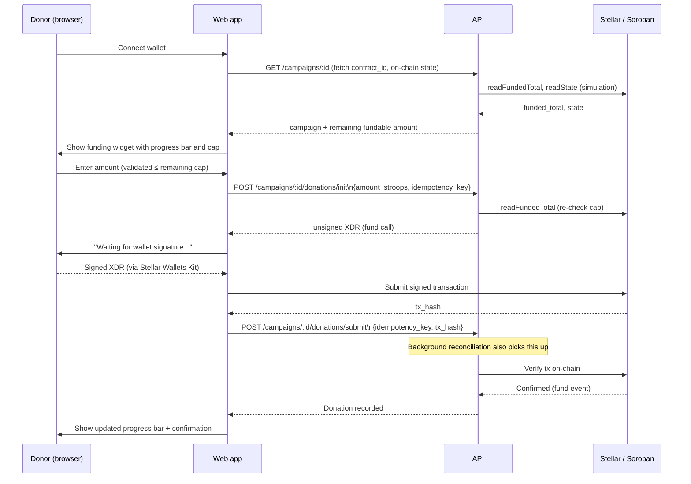
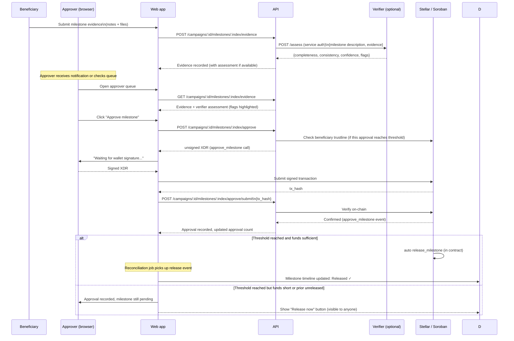
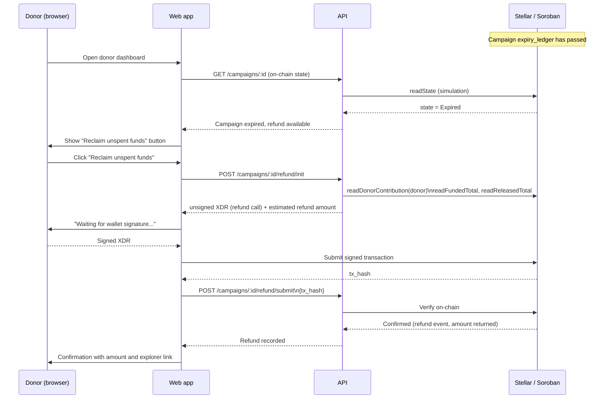
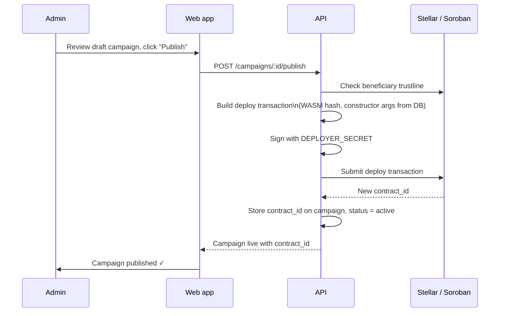

# Flows

Sequence diagrams for the three core on-chain flows. For full endpoint and contract details see [spec.md](spec.md).

---

## Donate flow

A donor selects an amount and funds a campaign milestone escrow.

**Over-cap guard:** The funding widget reads `funded_total` and the sum of all milestones. If the donor's amount would exceed the cap, the button is disabled and an inline message is shown before XDR is ever built.

---

## Milestone approval flow

An approver reviews evidence and signs an on-chain approval. When the threshold is reached the contract auto-releases (or a "Release now" button appears for anyone to trigger).

**Beneficiary trustline check:** Before building the approve XDR for the approval that would reach the threshold, the API checks that the beneficiary holds a trustline for the token. If not, it returns a `422` with a message directing the beneficiary to add the trustline.

**Release now:** `release_milestone` is callable by anyone once threshold is met and funds are sufficient. A "Release now" button appears on the campaign detail page for any pending milestone in that state.

---

## Refund flow

After a campaign expires, donors reclaim their pro-rata share of the unreleased balance.

**Pro-rata calculation (on-chain):** The contract computes the refund as `donor_contribution / funded_total × unreleased_balance`. The API reads this value after the fact via the verified event. The frontend shows an estimate (`donor_contribution - released_share`) before signing.

---

## Campaign publish flow (admin)

The deployer key signs only this transaction. It must hold enough XLM for base reserve + transaction fee, and nothing else.
